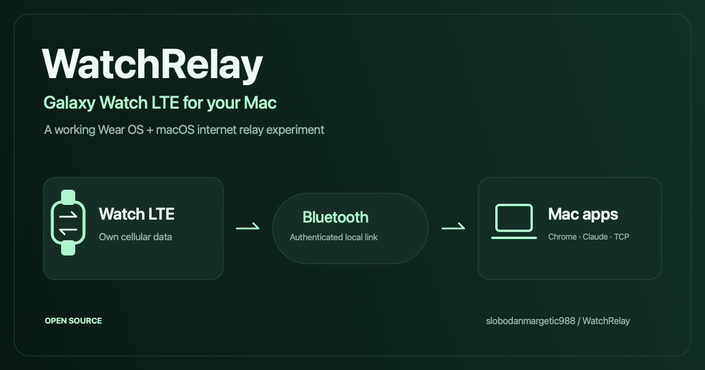

# WatchRelay



An experiment in using a Galaxy Watch5's own LTE connection as backup internet
for a Mac. A native Wear OS app opens cellular-bound sockets and carries traffic
over authenticated Bluetooth Classic RFCOMM. The Mac can expose a local SOCKS5
proxy or switch its default internet route through the watch.

**Prototype status. Measured relay speed is roughly 0.2 Mbps.** A matched
same-watch test found much faster direct LTE transfers, while a watch-local
transfer over the relay was similarly slow. The Bluetooth link and relay
software path are the current bottleneck. This is an interesting backup
connection for light use, with substantial room for improvement.

The physical tests demonstrated ordinary Chrome browsing and a completed
Claude Desktop request with Mac Wi-Fi off. Codex exchanged traffic through the
tunnel, but a completed Codex request remains unverified. A 15-minute light-use
run passed all 15 scheduled requests and consumed 17 battery percentage points
on the tested watch. See the [measurements and limits](docs/test-report.md).

[Support development](https://github.com/sponsors/slobodanmargetic988) ·
[MIT license](LICENSE) · [Mac-wide setup](docs/mac-wide.md) ·
[Protocol](docs/protocol.md)

## How it works

```text
Mac apps → local tunnel or SOCKS5 → Bluetooth RFCOMM → watch cellular sockets → internet
```

Everything runs on the watch and Mac. There is no hosted relay service to deploy
or operate. Mac-wide mode uses a pinned [sing-box](https://sing-box.sagernet.org/)
engine to route TCP and system DNS through the local WatchRelay proxy.

The watch requires an LTE model with working independent mobile data. The
implementation selects a cellular network explicitly, resolves destinations on
that network, and binds outbound sockets to it. HTTPS stays encrypted between
the app and its destination. The existing watch-to-phone pairing is preserved.

Automatic mode lets the watch find the Mac's service by UUID and reconnect after
a dropped link. One-time enrollment establishes mutual authentication. A lost
link closes its active requests, and a restored link accepts new requests.

## Current scope

- Apple silicon Mac and Galaxy Watch5 LTE, tested on macOS 27.2 and Android 16
  API 36 / Wear OS 6.
- Eight TCP streams in browser mode or 24 active streams in Mac-wide mode, with
  bounded queues, flow control, remote DNS, half-close, and cancellation.
- Mac-wide default internet routing with a local on/off switch, including
  startup while Mac Wi-Fi is off.
- Readable watch controls, private diagnostic logs, and automatic Bluetooth
  rediscovery after a channel change.

The tested carrier had usable IPv4 egress. The Mac-wide profile captures both
IP families, supplies IPv4 DNS answers, and rejects IPv6 and non-DNS UDP.
Applications can fall back from QUIC to TCP where they support it. Video calls,
UDP-only applications, corporate VPN combinations, off-wrist locking, and
all-day reliability still need work.

## Build

Install Xcode Command Line Tools, JDK 21, Python 3, Android SDK platform 36, and
Android build-tools 36.0.0. Set `ANDROID_HOME` and `JAVA_HOME` for your machine.
The project pins Gradle 8.14, Android Gradle Plugin 8.11.1, and Kotlin 2.2.20.

```sh
./scripts/build
./mac/test.sh
```

Outputs are `watch/build/outputs/apk/debug/watch-debug.apk` and
`mac/build/WatchRelay.app`. The watch package is `com.weeyuga.watchrelay`.
For Mac-wide mode, also complete the [local engine setup](docs/mac-wide.md).

## Install and pair

Keep the watch and Mac on the same Wi-Fi network during installation. Enable
Developer options on the watch by repeatedly tapping **Software version** in
**Settings → About watch → Software information**. Enable **ADB debugging** and
**Wireless debugging**.

Use the addresses displayed on the watch. The pairing port and connection port
are different and can change after Wi-Fi or debugging restarts.

```sh
adb pair WATCH_IP:PAIRING_PORT
adb connect WATCH_IP:CONNECTION_PORT
adb devices -l
./scripts/watch info WATCH_SERIAL
./scripts/watch install WATCH_SERIAL
./scripts/watch launch WATCH_SERIAL
```

Replace the placeholders with the current watch values. Older firmware may
show **Debug over Wi-Fi** with a direct connection address. The scripts require
an exact watch serial and check the Android watch feature before installing.
[Samsung wireless debugging guide](https://developer.samsung.com/sdp/blog/en/2024/04/30/connect-galaxy-watch-to-android-studio-over-wi-fi)

In WatchRelay, tap **Pair Mac**, allow discoverability, then pair the watch in
macOS Bluetooth Settings. Compare the displayed pairing codes. Tap **Start
session** on the watch for the initial forward connection.

```sh
mac=./mac/build/WatchRelay.app/Contents/MacOS/watchrelay
"$mac" doctor
"$mac" devices
"$mac" probe WATCH_NUMBER
```

Approve the Mac in the watch app if prompted. A successful hardware probe
exchanges matching Bluetooth messages while the watch makes a TLS-verified
cellular HTTPS request. Repeat it with watch Wi-Fi off and the phone disconnected
to verify the independent upstream. Wireless ADB disconnects when watch Wi-Fi is
off, while Bluetooth and app-owned logs can continue.

## Enroll automatic connection

While the watch's forward session is running, find its current channel on-screen.
If the firmware omits it, use wireless ADB to read the live assignment.

```sh
./scripts/watch channel WATCH_SERIAL
"$mac" enroll WATCH_NUMBER CURRENT_CHANNEL
```

Enrollment saves a private authentication key on both devices. Then tap **Stop
session** followed by **Auto-connect** on the watch. Routine automatic use finds
the service by UUID and needs neither a channel entry nor wireless debugging.

## Use it

For existing Chrome, Claude, and other TCP applications, follow the
[Mac-wide guide](docs/mac-wide.md). Double-click **Watch Internet.command** to
switch the default internet route through the watch and double-click it again
to restore the Mac's usual route.

For a separate temporary Chrome profile, double-click **WatchRelay.command**.
The launcher starts or reuses the Mac helper and opens regular Chrome with its
proxy configured. Apps with SOCKS5 support can use `127.0.0.1:1080` while the
helper is ready. Curl should use `socks5h` for watch-side DNS.

```sh
"$mac" auto WATCH_NUMBER
# Run in another terminal
./scripts/test-https relay
```

The local SOCKS port accepts connections from processes on the Mac without a
password. Keep it on loopback. Existing app connections may need a refresh when
switching routes or recovering from an interruption.

## Stop, restore, and remove

Switch **Watch Internet.command** off before ending a Mac-wide session. Restore
Mac Wi-Fi if you turned it off, then stop the Mac helper and watch session.

```sh
./"Watch Internet.command" off
./WatchRelay.command --stop
```

Tap **Stop session** on the watch. The standalone tunnel removes its temporary
route and resolver state when it stops. The [Mac-wide guide](docs/mac-wide.md)
covers recovery and removal of the optional signed sing-box app.

To export diagnostics, reconnect wireless ADB and run
`./scripts/watch logs WATCH_SERIAL`. Raw logs and local evidence are excluded
from version control. Review any exported files before sharing them.

To remove the watch app, run
`adb -s WATCH_SERIAL uninstall com.weeyuga.watchrelay`. **Forget Mac** in the app
clears its saved approval and enrollment. Disable wireless debugging if you
enabled it for this experiment.

## Support

WatchRelay is a personal open-source experiment. Contributions that improve
throughput, battery use, interoperability, or reproducible testing are welcome.
[Support the project through GitHub Sponsors](https://github.com/sponsors/slobodanmargetic988).
